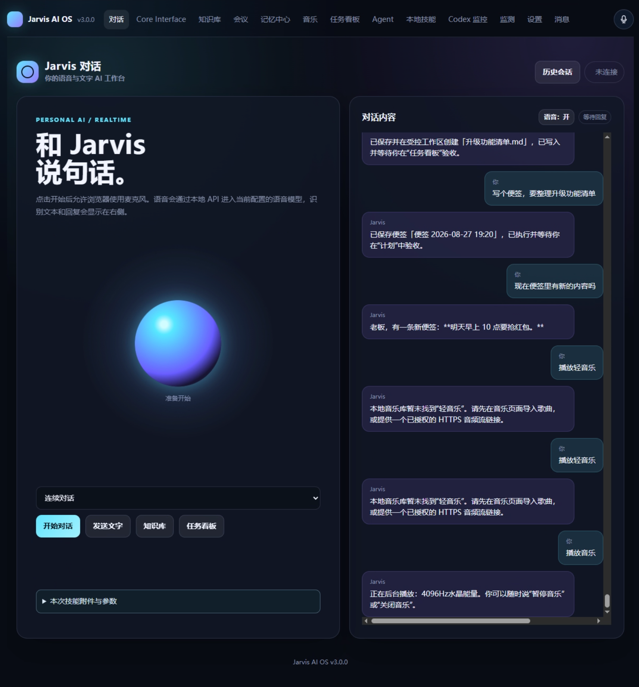

# Jarvis AI OS

### 不只是回答问题，而是把你的知识、记忆和行动连接起来。

Jarvis AI OS 是一个面向个人的 AI 工作台。它将文字与语音对话、长期记忆、知识库、会议、计划和受控 Agent 放在同一个系统中，让 AI 不再只是一个聊完就离开的窗口，而是逐步成为理解你的资料、延续工作上下文、协助推进事情的个人助手。

**这个项目想解决的，不是“再多一个聊天工具”，而是“怎样让 AI 真正融入一个人的日常工作”。**

> 本仓库是公开的项目介绍与界面展示，不包含项目源码、部署配置、运行数据或用户凭据，也不提供安装包与公开在线体验服务。

## 一眼认识 Jarvis

*用户提供的历史界面截图，保留原有 v3.0.0 标识，用于展示产品形态。下文按 v3.2.0 项目资料整理；截图不是最新版本或全部能力已启用的证明。*

从同一个工作台，你可以和 Jarvis 说话、查询自己的资料、整理会议内容、记录备忘录，也可以把需要执行的工作交给受控任务流程，并查看过程和结果。

## 为什么做这个项目

很多 AI 工具很擅长回答当前问题，但个人工作通常不是一次问答就能结束的：

- 一份资料在文件夹里，一段讨论在聊天记录里，一条待办又在另一个应用里。
- 昨天已经解释过的背景，今天可能还要重新说明。
- 会议结束拿到一段转写，却仍需要自己寻找结论、核对原文、整理下一步。
- AI 给出了建议，但建议有没有变成任务、执行到哪里、结果能否接受，缺少连续的记录。

Jarvis 尝试把这些分散环节连接起来：**以对话作为入口，以个人资料和可核对的记忆提供上下文，以任务和技能把事情推进，再由人确认结果。**

模型负责理解与推理，系统负责记录、权限、执行和证据；两者分工，而不是让模型的一句“完成了”代替实际完成。

## 核心功能

| 能力 | 可以做什么 | 对用户的意义 |
| --- | --- | --- |
| 文字与语音对话 | 通过文字或语音提问，延续历史会话；支持实时语音路线和本地识别、推理、播报的组合路线 | 减少入口切换，让表达需求更自然 |
| 长期记忆 | 管理候选记忆，审核、纠正、合并冲突并保留来源证据 | 重要背景可以持续积累，而不是每次从头解释；错误记忆也能被修正 |
| 文件与知识库 | 管理文档和文本，导入网页资料；检索问答、查看引用、定位原文与原页 | 回答可以回到自己的资料中核对，而不是只依赖模型的泛泛印象 |
| 会议工作台 | 录音或导入已有音频，转写并人工修订；整理纪要、待办，支持会议问答和片段回听 | 让会议从一段录音变成可检索、可复盘、可继续使用的知识 |
| 计划、提醒与备忘录 | 记录想法、项目和任务，设置截止时间与循环提醒，跟踪进展和等待验收状态 | 将“想到一件事”连接到“持续推进这件事” |
| 受控 Agent 与 Codex 协作 | 创建执行计划，查看进度、日志、文件变化和产物；支持取消与用户验收 | 执行过程可见、结果可检查，重要动作保留人的决定权 |
| 本地技能中心 | 导入和管理能力包，核对安装范围，独立试运行、显式启用，再执行并下载结果 | 把已有工具接入同一工作台，让能力按需要扩展，而不是全部重做 |
| 本机辅助能力 | 通过受控动作打开浏览器、管理本地音乐播放等 | 让助手与电脑上的实际工作发生联系，而不只停留在聊天页面 |
| 多端与数据管理 | Web 工作台、Android 私有入口和 Windows 本机桥接；提供设备配对、撤销、备份与恢复机制 | 围绕同一套个人工作上下文协作，同时保留访问和数据管理入口 |

上述能力依赖具体模型、服务、设备权限与配置；已有实现不等于每个环境都默认开启，也不表示所有真实场景已经验收。

## 它可以怎样融入一天的工作

### 开始工作：从自己的上下文继续

先查看昨天留下的备忘录和任务，再围绕相关资料向 Jarvis 提问。需要核对时，回到文档引用和原文，而不是重新从零描述整个项目。

### 开会之后：把讨论变成可复用的资料

录音或导入会议音频，检查和修订转写，整理纪要与待办。以后再次讨论同一问题时，可以检索会议内容，并回听关键片段，减少信息只停留在录音里的情况。

### 推进任务：不止得到建议，也能检查结果

将支持的工作交给已配置并获准的 Agent 或技能，查看计划、执行状态和产物。遇到问题可以取消或人工处理；内部检查通过后，仍由用户决定是否验收。

这些是能力组合的使用方式，不代表一句自然语言就能自动串联所有流程，也不是对任意任务成功率的保证。

## 项目的意义

### 1. 从“临时问答”走向“持续协作”

个人工作有历史、有偏好、有长期目标。Jarvis 关注的不只是这一轮回答，而是让会话、资料、记忆和任务之间保留联系，让下一次协作能够承接上一次的积累。

### 2. 让个人知识成为可以使用的资产

文档、会议和备忘录不应只是一堆保存下来的文件。通过检索、引用、修订和复盘，它们可以逐渐成为支持判断与行动的个人知识体系。可追溯的来源比一段听起来正确的回答更重要。

### 3. 在效率与控制权之间保留边界

能执行，不意味着应当无条件执行。Jarvis 将范围确认、权限、停止、日志和验收纳入流程，让“交给 AI 帮忙”仍然保留检查与接管的空间。恢复记录也不应被当作自动重跑旧任务的许可。

### 4. 以用户控制的数据基础承接不同模型

原始数据与任务状态由本机或用户控制的自托管服务保存，本地与云端模型通过可替换的接口接入。希望长期保留下来的是个人的知识与工作记录，而不只是对某一个模型或服务的依赖。

这不等于所有处理都离线：启用云端模型或外部服务时，相关内容可能按具体配置发送给提供方；实际隐私和安全边界仍需逐项核对。

### 5. 让已有工具继续发挥作用

通过本地技能与外置适配，把适合的独立工具接入统一入口，保留原程序的使用方式。项目的方向是建立可扩展的个人工作台，而不是要求所有功能只能由一个应用重新实现。

## 适合关注这个项目的人

- **知识工作者**：日常需要处理资料、会议、待办与长期项目。
- **内容创作者**：希望把素材、转写、想法和任务放进连续的工作流程。
- **开发者与 AI 工具探索者**：关注模型如何连接个人上下文，以及执行如何做到可检查、可接管。
- **重视数据管理的人**：希望了解本地、自托管与云端能力如何合理分工。

## 当前阶段与边界

截至 **2026-10-12**，项目源码版本为 **v3.2.0**。对话、记忆、知识库、会议、任务和受控执行等已有实现，本地技能与 ASR 配套持续完善中。

部分 Docker 依赖执行、ASR 宿主监督及恢复流程已有隔离验证，但网页授权衔接、完整资源/模型环境、不同平台兼容性和真实设备体验仍有待完成。Android 正式发布、真实麦克风与语音质量、生产恢复等不能仅凭测试结果宣称交付。

Jarvis 不是可以无限制控制电脑的通用代理，也不承诺任意程序安全运行、所有内容完全本地处理或自动完成所有工作。**可见的过程、明确的权限、可核对的结果，以及用户的最终确认，是项目持续坚持的方向。**

## 关于这个展示仓库

这里仅发布项目介绍和用户提供的界面图片，方便了解 Jarvis 的功能、理念与进展。仓库不包含源码、模型文件、数据库、真实凭据或部署脚本；公开展示不等于项目源码开源。

欢迎通过 [Issues](https://github.com/Tom8the/JarvisAIOS-Showcase/issues) 交流使用场景、产品建议和希望解决的问题。请不要上传 API Key、Cookie、个人文档或其他敏感信息。

---

**Jarvis AI OS 的目标：让 AI 不只理解你的问题，也能在明确边界内，陪你把事情一步步做完。**
